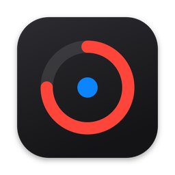
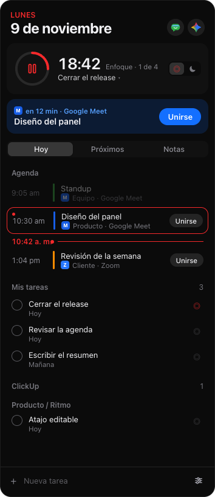
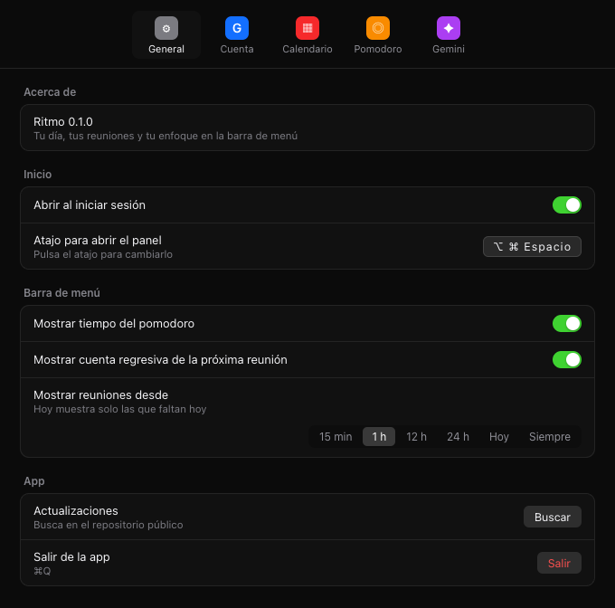
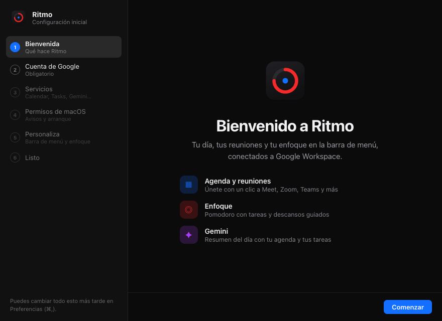

<p align="center">
  
</p>

<h1 align="center">Ritmo</h1>

<p align="center">
  Tu día, tus reuniones y tu enfoque, en la barra de menú.
</p>

<p align="center">
  macOS 11 o posterior
</p>

Ritmo vive junto al reloj. Abre la agenda del día, únete a la reunión que está en curso y sigue un pomodoro sin salir de lo que estás haciendo.

<p align="center">
  
  &nbsp;&nbsp;
  
</p>

<p align="center">
  
</p>

## Qué hace

- Muestra el día en la barra de menú y se abre con un clic o con ⌥⌘Espacio. El atajo se puede cambiar.
- Marca la reunión en curso y deja unirse a Meet, Zoom, Teams, Webex, Slack y otros enlaces.
- Lleva un pomodoro ligado a una tarea, con descansos y una pausa cuando empieza una reunión.
- Reúne Google Tasks y ClickUp, y las notas se quedan en este equipo.
- Resume el día con Gemini a partir de la agenda y las tareas.
- Abre Google Chat en su propia ventana.
- Busca actualizaciones firmadas en las releases de este repositorio.

## Privacidad

Ritmo usa una sola cuenta de Google. Las claves de Gemini, Factorial y ClickUp, y la sesión de Google, se guardan en el llavero de macOS. No van en el repositorio ni en el binario.

Cómo crear cada clave está en [docs/claves.md](docs/claves.md). La misma guía se abre desde Preferencias → Claves.

## Compilar

```bash
npm install
npm run dev
```

Hace falta Node 18 o posterior, Rust estable y las Command Line Tools de Xcode. El detalle está en [DEVELOPMENT.md](DEVELOPMENT.md).

`npm run build` genera la app. Para publicar una versión, sube el número y crea el tag `vX.Y.Z`: el workflow construye macOS arm64 e Intel y sube la release que Ritmo instala desde Preferencias.
